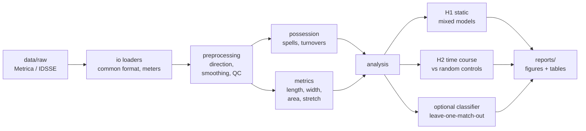

# Technical Architecture

## Design principles

1. **Raw data is read-only.** Every step reads from one folder and writes to
   the next (`raw → interim → processed → reports`). Any result can be rebuilt
   from raw data with one command.
2. **One config file.** All parameters (seed, pitch size, window lengths,
   thresholds) live in `configs/default.yaml`. A sensitivity analysis is just
   another YAML file.
3. **Logic in `src/`, exploration in `notebooks/`.** Notebooks import functions
   from the `pmi` package and never define analysis logic themselves. This
   keeps the logic testable and stops copy-paste drift between notebooks.
4. **Small, pure functions.** Most functions take a DataFrame and return a
   DataFrame, and each has a unit test on a small synthetic example where the
   right answer is known (for example, a square of players with a known area).
5. **No infrastructure before results.** No database, Docker, API or web app
   until the research pipeline works. A web demo is reconsidered in Phase 5
   only if it adds real value.

## Folder structure

Items marked *(Phase 3)* are created when they are implemented, not as empty
placeholders.

```
player-movement-intelligence/
├── configs/
│   └── default.yaml          # every analysis parameter + random seed
├── data/                     # NOT in git
│   ├── raw/                  # downloaded datasets, never modified
│   ├── interim/              # cleaned per-match tracking/events (parquet)
│   └── processed/            # analysis tables: per-frame metrics, turnovers
├── docs/                     # proposal, audit, literature, architecture
├── notebooks/                # numbered exploration notebooks (call src/ only)
├── reports/
│   ├── figures/              # final figures, regenerated by scripts
│   └── tables/               # final result tables (CSV)
├── scripts/
│   ├── download_data.sh      # fetch raw data (pinned versions)
│   ├── build_interim.py      # raw → validated common-format parquet (make interim)
│   ├── preprocess.py         # interim → data/processed + QC table (make preprocess)
│   ├── build_possession.py   # spells, turnovers, EDA figures (make possession)
│   ├── build_shape.py        # per-frame shape metrics + example frame (make shape)
│   ├── run_h1.py             # H1 tables and figure (make h1)
│   └── run_pipeline.py       # (Phase 3) end-to-end: raw → figures
├── src/pmi/
│   ├── config.py             # load YAML, resolve paths, set seeds
│   ├── io/                   # dataset loaders → one common format (in meters)
│   │   ├── common.py         #   schema, coordinate conversion, goalkeeper detection, validation, parquet I/O
│   │   ├── metrica.py        #   Games 1–2 CSV and Game 3 via kloppy
│   │   └── idsse.py          #   (later) replication dataset
│   ├── preprocessing.py      # direction (180° rotation), velocities + speed QC, ball in play
│   ├── possession.py         # possession spells, per-frame possession, turnovers + funnel
│   ├── metrics.py            # length, width, hull area, stretch index, centroid
│   ├── analysis/             # (Phase 3)
│   │   ├── static.py         #   H1: spell-level mixed models + sensitivity variants
│   │   ├── timecourse.py     #   H2: turnover-aligned curves + controls
│   │   └── classify.py       #   optional: leave-one-match-out classifier
│   └── viz.py                # shared figure style, validated colours, pitch drawing
├── tests/                    # pytest unit tests, one file per module
├── Dockerfile                # container image (uv + locked deps)
├── docker-compose.yml        # `app` (tests/commands) and `jupyter` services
├── Makefile                  # local (uv) and docker-* shortcuts
├── .python-version           # Python 3.12, read by uv
├── pyproject.toml            # package metadata + dependency ranges
└── uv.lock                   # exact versions of every dependency (committed)
```

## Common data format

Every loader (`io/metrica.py`, `io/idsse.py`) outputs the **same long-format
tables**, so all later code is dataset-agnostic. That is what makes the
replication a re-run rather than a rewrite.

**tracking** (one row per player per frame)

| column | type | meaning |
|---|---|---|
| match_id | str | e.g. `metrica_1` |
| period | int | 1 or 2 |
| frame | int | provider frame index |
| time_s | float | seconds since period start |
| team | str | `home` / `away` |
| player_id | str | unique within match |
| is_goalkeeper | bool | |
| x, y | float | meters, origin at pitch centre |

The ball goes in a separate table with the same keys minus team and player.

**events**: match_id, period, frame, time_s, team, type, subtype, player_id,
x, y, end_x, end_y.

## Pipeline



## Technology choices

| Need | Choice | Why |
|---|---|---|
| Tables | pandas + pyarrow (parquet) | Parquet loads about 10× faster than CSV and keeps data types |
| Geometry | `scipy.spatial.ConvexHull` | Standard and tested; no need to write our own |
| Statistics | statsmodels `MixedLM` | Mixed-effects models with match/team random effects |
| ML (optional) | scikit-learn | `LeaveOneGroupOut` gives a by-match split out of the box |
| Game 3 / IDSSE parsing | kloppy | Maintained open-source parser for EPTS and other provider formats |
| Plots | matplotlib (paper figures), plotly (interactive exploration) | |
| Environment | uv (`uv.lock`) + Docker | uv installs the exact locked versions in seconds; Docker gives the same OS and Python everywhere |
| Reproducibility | config YAML + seed + `uv.lock` + pinned data commit | |

**Not used for now:** OpenCV and PyTorch (no video in the core RQ; may come
back for the pose extension), FastAPI/React, databases, DVC, MLflow.
Docker is used only as a reproducible runtime, not for deployment.
